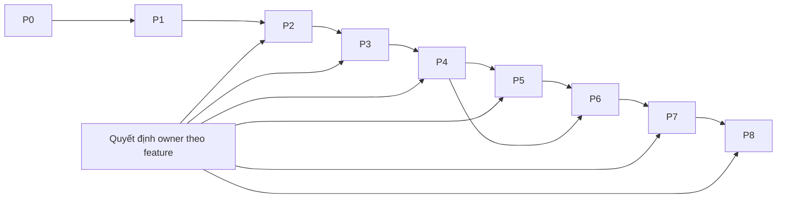

# 6. Kế hoạch triển khai theo dependency

> Cập nhật leader-field-contracts-20261013-r2: 23/23 đề xuất NR01..23 đã được chủ nhiệm duyệt. Đọc 05/05C/05D bản mới và 07 — Gói việc. Những câu mô tả “chưa chốt” trong trích nguồn là trạng thái lịch sử. Binding nguồn chưa đủ vẫn có lỗi cụ thể theo schema; không đồng nghĩa chủ nhiệm chưa duyệt. Chưa có phase sản phẩm mới được đánh Passed trong lượt hoàn thiện tài liệu này.

Ngày 13/10/2026. **Các phase sản phẩm dưới đây chưa chạy trong lượt bàn giao hồ sơ này.** Gate chỉ được đánh đạt từ DWG/PDF do DBTool thực sự sinh ra, có số đo và kiểm nội dung. Số test pass không phải tiêu chí nghiệm thu.

## 6.1. Thứ tự và quyền quyết định

23 đề xuất trong tài liệu04 đã được chủ nhiệm chấp thuận; các binding dữ liệu còn thiếu chỉ chặn feature/case phụ thuộc. Junior vẫn triển khai type, interface, diagnostic và phần đã có căn cứ. Không lấy một quyết định chưa chốt để dừng toàn bộ dự án; không đặt default thay quyết định đó. Approval cần scope, rule version, nguồn và người chốt; version phải đi vào input/output hash trước khi chạy lại case.

Giữ J00–J08/K0–K7 làm ánh xạ lịch sử. P0–P8 là thứ tự triển khai hợp nhất, không phải pipeline sản phẩm thứ hai.

## 6.2. Phase, artifact và acceptance gate

| Phase / gói cũ | Dependency | Công việc và nơi sửa | Artifact phải lưu | Gate đo trên DWG/PDF |
|---|---|---|---|---|
| P0 / J00 / K0 | Không | Chụp hash code/build/template/workbook/run cũ. Chọn ReferenceBundle theo identity/CT/kích thước/frame. | Baseline manifest; content-before; link DWG/PDF; trạng thái từng case. | Nguồn/hash/identity khớp; phân biệt InputDifference với regression. Không ghi đè bằng chứng; chưa chạy giữ NotRun. |
| P1 / J01 / K1 | P0; NR15/16 cho template Final | S0/S1: registry/schema/importer/field contracts; request chung UI/CLI; semantic keys prefix/NoteStyle/PitchSymbol/panel scale. | AssetRegistry; RawInput; field-consumer-map; DWG import/readback và PDF crop font. | Active field có type/unit/SourceRef; thiếu catalog/version/formula bị chặn. Exact block/tag/dependency; không nhân INSUNITS; chữ Việt trên output đúng. |
| P2 / J02–03 / K1 | P1; NR23 cho panel BTCT tự thiết kế; NR09 cho catch product | S2/S3: cover/cổ/frame100/datums; optional Pad; profile cống; catch assembly/owned void; union. | Effective input/source diff; surface/opening maps; geometry hash; DWG/PDF MB/AA/BB. | Native DIM đúng Excel/rules; CT tại FinishedTop; same OpeningId nhất quán; sản phẩm1:1; PadOFF không hình/nhãn; giữ lỗ/joint loại 2/3. |
| P3 / J04 / K2 | P2; NR01–08/19–21 theo feature | S4: mesh/clip/hooks/C-U-Z/thang/chốt-hole/vạt/lifting/panel/catch; compose đúng StageAdapters. | Occurrence/station/clip/length/support/collision ledgers; native paths/holes; DWG/PDF view required. | ON có path thật/native handle; OFF vắng path/symbol/TK; cover/void/anchor đúng; pair1:1; basis approved. Thiếu rule giữ Partial với NR-ID. |
| P4 / J05 / K3 | P3; NR10–13 theo case | S5: group trước Drawing; compatibility key/vùng/member lengths/scoped marks; mapper sau vẽ thành validator. | Presentation groups; canonical/member map; DWG/PDF bốn vùng cắt. | Mỗi member một primary accounting group; mean/rawsum từ Li; ba output cùng GroupId; rename/reorder không đảo vùng; không fuzzy alias. |
| P5 / J06 / K4 | P4; NR02/08/13/14 theo shape/quantity | S8: nativeTK21schema/schematic recipe; thay round generic route, giữ AngleTK.TG/QuantityTable. | Intents/bindings/readback; glyph hashes; DWG/PDF TK/bending/panel/catch tables. | INSERT/ATTRIB exact; TDAI đổi đơn vị một lần; không ATT mẫu; Tenluoi cùng row đầu; caption/Ø/DAI khớp group; glyph không scale theo Li. |
| P6 / J05 / K5 | P4/P5; NR16/22 cho font/ink | S6/S7: targets/collector/Gach/BLTC/shared lanes/DIM/CT/material/cổ/trần/section labels. | Anchor/target/ink/collision receipts; DWG/PDF view liên quan. | Không label sai target/face/layer hoặc Gach trong lỗ; paper metrics đúng20/30/40; tuyến không đè chữ/DIM; nội dung không mất; layout-only giữ geometry hash. |
| P7 / J07 / K6 | P5/P6; NR18/22 | S9: recipe/fit toàn ink/phân trang/FrameRegistry/panel scale; loại 3 NeckCatch+ScheduleOnly. | Sheet contract; frame windows; DWG/PDF nhỏ/lớn và overflow lịch sử. | Đủ required roles hoặc N/A đúng input; ink trong frame; không crop/shrink chữ; fixed scale giữ; MB/AA/BB cùng assembly; đúng bundle nguồn. |
| P8 / J08 / K7 | P7; mọi NR ảnh hưởng case đã ký | S10/S11: production batch/update/save-reopen/plot một host; ma trận và batch5/10. | Actual DWG/vectorPDF/WebP; native handles; plot/session/update/recovery/comparison/visual receipts; deliveries index. | Đủ selected row hợp lệ; lỗi row không bị bỏ; identity đúng từng frame; UpdateB không đổi A; DWG đúng Excel/PDF đúng recipe; mỗi gate có evidence của chính case. |

## 6.3. Cách junior thực hiện một ticket

1. Chọn module03/phase trên, kiểm hash/symbol/caller hiện tại. Workspace đổi thì rebaseline đúng file; không patch theo line number cũ.
2. Ghi ticket: ID; rule K/EX/NR; field/unit; call chain; input/build/template hashes; expected/actual; affected views; artifact dùng nghiệm thu.
3. Tìm tầng đầu tiên mất/đổi dữ liệu. Giữ native readback/crop trước sửa; sửa tầng đó, không bù tọa độ ở renderer.
4. Implement theo 05/05A/05B/[05C](05C-IMPLEMENTATION-CONTRACTS.md). Thiếu approval thì implement typed decision payload và `RULE_UNAPPROVED` đúng scope; giữ canonical/ownership/feature gates; không đổi ON thành OFF.
5. Rebuild project bị ảnh hưởng, kiểm assembly hash host thực load. Managed tests tìm regression logic; nghiệm thu cần actual DWG/PDF.
6. Chạy ca lỗi, ca đổi một biến, ca đảo ON/OFF và profile liên quan. Chỉ mở rộng kiểm khi còn nghi vấn hoặc tới P8; không lặp số test để thay bằng chứng.
7. Lưu before/after ở raw/effective/geometry/rebar/group/annotation/native/PDF. Migration log ghi sửa/thêm/bỏ và lý do; khác input không tự là regression.
8. Đóng ticket khi gate đúng scope có evidence. Thiếu rule ghi NeedsRule; chưa chạy ghi NotRun; code mới không đồng nghĩa Fixed.

Các câu hỏi domain còn lại đã có đề xuất cụ thể trong04. Junior không tự thiết kế lại hoặc đoán thông số; chủ nhiệm chốt record theo scope.

## 6.4. Record nghiệm thu bắt buộc

| Nhóm | Fields | Điều kiện |
|---|---|---|
| Identity | CaseId,RunId,Profile,MainSheet,SelectedRow,ManholeId | Duy nhất, liên tục tới frame/PDF. |
| Provenance | WorkbookHash,EffectiveInputHash,BuildHash,TemplateBundleHash,RuleVersions | Khớp bytes/build/rules thực tế. |
| Reference | PDF IDs/source hashes/CAD frame IDs/join status/recipe role | Không lấy Modelordinal/ga khác làm numerical baseline. |
| Check | Name,SubjectId,SourceRefs,Expected,Actual,Unit,ToleranceRuleId,NativeHandles,EvidencePaths,Verdict | Passed có expected/actual/evidence; không count test. |
| Completeness | RequiredViews/Tables/Annotations,ActualIds,N/A reasons | N/A do input/constraint, không do chưa hỗ trợ featureON. |
| Status | Input,Geometry,Steel,Projection,Sheet,Native,Plot,Visual | Gate riêng; không suy Passed từ exit0. |
| Review | Reviewer,RegionsViewed,NeedsRuleIds,SourceDifferences,Notes | Ghi đúng vùng đã xem và phần chưa kiểm. |

Schema example có thể dùng null minh họa cấu trúc; record thật đánh Passed không được thiếu dữ liệu bắt buộc. Số fixture chỉ nhận dạng source, không thay expected từ Excel/rules hiện hành.

## 6.5. Bộ ca phải nghiệm thu

Giữ `ACCEPTANCE-CORE-216` và `ACCEPTANCE-EDGE-40` như danh sách yêu cầu, không baseline Passed. Core: ba loại × chânON/OFF × vạtON/OFF × nhỏ/vừa/lớn × không cống/tròn/hộp. Rà validity theo effective constraints; N/A có lý do. Variation input có receipt; product không lookup theo tên fixture.

| Trục | Ca cần chạy | Phép đo/evidence |
|---|---|---|
| X/Y/H | Đổi độc lập; nhỏ/lớn; AA overflow G1250/Plan overflow G1500 lịch sử. | Native DIM/path so EffectiveInput; same OpeningId crossview; ink containment. |
| Nắp/cổ | Mã vuông/chữ nhật; hướng0/90; thickness125/150/200 là variation có receipt. | Clear aperture/footprint formula/frame100/product1:1/CT tại FinishedTop. |
| Lót/chân/vạt | OFF/ON độc lập; Pad0/50/100/âm; vạt đáy/trần/both. | Không phantom Pad; union outer/inner/joints; thép vạt trong support; input âm bị chặn. |
| Cống | No/round/box/doublebox; offset−/0/+; bốn tường; nhiều lỗ/giao/chồng/tiếp tuyến. | Contours catalog; endpoints analytic; retained+removed conservation; ownership/frame trace. |
| Lưới/móc | Pitch/delta/Ø/cover/distribution/hook khác nhau. | Stations/gaps, cover envelope/bend path/basis; không móc giả trong DAI. |
| C/U/Z | Mỗi component; Đều/Lệch; pitch khác2mesh; OFF do pitch vượt span. | Path/bo/support/station; BLTC nối tie thật; missing rule chặn Final. |
| Thang/chốt/lifting | ON/OFF; Ø/pitch/length/startDrop; va cống/catch. | Rung/path/hole pair/host/source; không D18 cứng/blanket block loại 3. |
| Cửa thu | Body/Neck; Left/Center/Right cho Body; hướng/size/mesh/pad. | Cùng assembly MB/1-1/2-2; owned void/product match; shape 1..4/TKCT approved; NeckCenter có source override. |
| TK/bending | C/U/Z/VG/ring/rectangle/panel/lifting/angle/catch; Li biến thiên. | INSERT/ATTRIB exact; mean/rawsum/units/fixedglyph hash; không gộp sai scope/role. |
| Scale/font/OCS | Body20/30/40, panel20; rotation/mirror/normal−Z. | Physical geometry không đổi; paper text/ink/underline; native style/PDF crops. |
| Naming/config | Tên bất kỳ; prefix/pitchsymbol/Style2; reorder IDs. | Geometry/canonical members bất biến; display đúng config; suffix không nhảy. |
| Batch/update/recovery |5row/10row/ba loại;1row lỗi;UpdateB;cancel/timeout/hostexception. | Row receipts/frame identity; NOD/XData/geometry củaA giữ; rollback; một host plot session khi thành công. |

Object/row counts chỉ kiểm đủ nội dung. Kết luận đúng cần số đo subject, target association, native attributes và output regions đã xem.

## 6.6. Gỡ code và rollback

- Sau P4, đổi nguồn groups sang planner trước Drawing; mapper cũ giữ validator/readback.
- Sau P5, chuyển roundsteel sang native planner rồi mới gỡ generic branch trong VHG scope; giữ QuantityTable/AngleTK.TG.
- Sau P6/P7, gỡ static catch khi projector mới đủ ba view. Trích recipe/glyph/schema trước khi loại Family21 stores khỏi production compile; giữ archive hash.
- SheetFourViews/SheetFiveViews/SheetThreeRoofViews còn constants ID phải migrate methods/bounds riêng. Cập nhật mọi caller trong03 và cross-reference tests/tools; compile consumer bị ảnh hưởng, không delete cả file.
- Legacy Core/Cad/IO giữ compatibility island tới shared-use-case parity. No-hit không chứng minh dead/public API bỏ được; reflection/external addin cần migration version.
- Rollback code bằng version control/snapshot có hash; rollback DWG theo transaction/generation ownership. Template migration dùng chung chưa chứng minh không ảnh hưởng ga khác phải bị chặn trước mutation. Workbook nguồn và run lịch sử giữ nguyên.

## 6.7. Điều kiện kết thúc sản phẩm

P8 đạt khi mọi case hợp lệ thuộc scope có required gates Passed từ actual DWG/PDF của chính case; NR ảnh hưởng đã có approval/version; featureON không bị tắt; native assets/schema/units/identity đúng; provenance liên tục. Partial/Failed/NotRun hoặc N/A thiếu lý do chặn công bố “hoàn chỉnh, zero lỗi”.

Bước tiếp theo là thực hiện W01/P0 và W02/P1; 23 đề xuất đã duyệt, không trình lại. Việc đã rõ như OptionalPad, thiếu catalog, đơn vị TDAI và nativeTK interfaces triển khai theo dependency mà không phải đợi chốt mọi NR. **Bàn giao kiến trúc không phải chứng nhận phần mềm đã đạt.**

## 6.8. Gói thực thi và phê duyệt cập nhật

| Phase | Gói thực hiện | Dependency |
|---|---|---|
| P0 | W01 | none |
| P1 | W02 | W01 |
| NEW-A | W03 | W02 |
| NEW-B | W04 | W03 |
| NEW-C | W05 | W02 |
| P2 | W06 | W02, W03 |
| P3 | W07 | W06 |
| P4 | W08 | W07, W03 |
| P5 | W09 | W08, W04 |
| P6 | W10 | W09, W04 |
| P7 | W11 | W10 |
| REMOVE | W12 | W11, W03, W04 |
| P8 | W13 | W12, W05 |

116 module bổ sung, 10 module mới và 6 module gỡ đã được map đến path cụ thể trong 07; 168 module reuse không có gói sửa. Acceptance phase giữ NotRun đến khi có DWG/PDF thực tế. W02 thêm 3 file DTO để compile contract; envelope S7/S8 không tạo dependency Drawing→Application.
