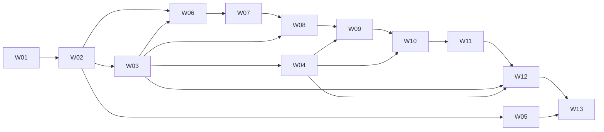

# 07 — Gói công việc một lần copy-paste

Phiên bản leader-field-contracts-20261013-r2. Đầu ra lần này là đặc tả triển khai và prompt, chưa phải bản phát hành DBTool đã nghiệm thu DWG/PDF.

23 đề xuất NR-01..23 đã được DucBao chấp thuận trực tiếp ngày 13/10/2026 (OWNER-APPROVAL-23-20261013). Không yêu cầu duyệt lại các đề xuất này. ApprovedProposal xác nhận lựa chọn đã mô tả; không tạo ra giá trị nguồn chưa có trong đề xuất. Binding sản phẩm/shape/đơn vị/tolerance thiếu dữ liệu trả `RULE_BINDING_DATA_MISSING` có field/source/debug; không hỏi giữa chừng và không tự bịa.

Pipeline có một chuỗi S0–S11. DTO envelope tích lũy giữ roots đã tính immutable; OUT của stage N bằng IN của N+1. Đây là thay đổi hợp đồng phần mềm được ghi trong NR-IO-001. Drawing chỉ nhận Domain/Drawing payload, Application adapter sở hữu envelope; không tạo dependency Drawing→Application. S8 dùng registry nhóm, không đo glyph để tính chiều dài; thứ tự thực thi chuẩn vẫn đặt S8 sau S7 để kiểm tính liên tục I/O.

Có 13 gói: 9 phase P0–P8 riêng, 3 nhóm chức năng viết mới và 1 gói gỡ 6 module cùng caller. Mỗi module trong 116 module BỔ SUNG được gắn đúng một phase chính; 168 module TÁI SỬ DỤNG không có gói sửa. Ba file DTO nền tảng ở W02 là phần bổ sung để compile hợp đồng giữa các project; thay đổi này được ghi rõ và không tăng số gói.

## B3 — Format đề xuất áp dụng giống nhau cho cả 13 gói

| Mục bắt buộc | Tên | Nội dung |
|---|---|---|
| B3.01 | Định danh và kết quả phải giao | PackageId, phase, version, owner, dependency receipts; file code và phạm vi hoàn thành. |
| B3.02 | Môi trường và điều kiện đầu vào | Quyền truy cập repo/workspace, net8.0, host cần thiết; kiểm dependency, thay đổi so với baseline và cách báo thiếu điều kiện. |
| B3.03 | Phạm vi file và ranh giới chỉnh sửa | Đường dẫn file, symbol và caller cụ thể; quyền sửa từng method của file dùng chung; giữ code từ gói trước. |
| B3.04 | Quy tắc domain và quyết định đã duyệt | Nhúng 23 đề xuất, nguồn, đơn vị; cấm fixture, fuzzy grouping và đo schematic; lỗi khi thiếu binding. |
| B3.05 | Stage I/O và DTO tới field lá | Nhúng type declarations và bảng leaf IN/OUT/FAIL của stage thuộc gói; không cần đọc file 05C. |
| B3.06 | Công thức, hằng số và input binding | Nhúng 49 công thức và 206 input bindings; mọi giá trị kỹ thuật có nguồn. |
| B3.07 | Thuật toán và thứ tự sửa cụ thể | Nhúng stage pseudocode và toàn bộ helper bodies;không để hàm domain chỉ có tên. |
| B3.08 | Interface, caller và migration | API baseline thực tế,new signatures,integration ports,compatibility island;không thêm project cycle. |
| B3.09 | Nhánh lỗi, edge case và dữ liệu debug | Complete error payload,active/inactive,ownership,multiopening,units,collision,pagination,postcommit recovery. |
| B3.10 | Thứ tự kiểm tra và acceptance gate | Kiểm compile/schema sớm trước khi chạy host; đo DWG/PDF thực tế; ghi NotRun khi thiếu host hoặc bằng chứng. |
| B3.11 | Token và cách giao code trong một lần | Ngân sách input/source/output; ghi code vào workspace; không cắt file hay thay bằng ellipsis; không cần paste lần hai. |
| B3.12 | Receipt và tự kiểm cuối | Hash file thay đổi, interfaces, dữ liệu thiếu, gate đã chạy và cách khôi phục; không gắn ProductPassed từ số test. |

## Context model và ngân sách

Google công bố Gemini 3.8 Flash có giới hạn input 1,048,576 và output 65,536 tokens. [Nguồn model chính thức](https://ai.google.dev/gemini-api/docs/models/gemini-3.8-flash). Khoảng token của mỗi prompt được ước tính bằng số ký tự/4 đến số byte UTF-8/2; chưa gọi API tokenizer nên đây không phải số đếm chính xác. [Google count tokens](https://ai.google.dev/gemini-api/docs/tokens). Mỗi gói dành thêm 128,000 tokens để đọc source có chọn lọc, 49,152 cho output và 16,384 cho thinking/headroom. Code được ghi vào workspace; phản hồi cuối không in lặp lại toàn bộ source.
| Thứ tự | Phase / tên | Chờ | Prompt tokens ước tính | Code output ước tính | Ngân sách cộng source/output/headroom |
|---|---|---|---|---|---|
| W01 | P0 Baseline và bằng chứng | none | 123871–250516 | 4000–32000 | 444052 |
| W02 | P1 Schema, DTO, import và nguồn duyệt | W01 | 142731–288828 | 12000–46000 | 482364 |
| W03 | NEW-A Registry, nhóm thép và biên hình học | W02 | 209746–423784 | 28000–44000 | 617320 |
| W04 | NEW-B Projector, nhãn và native TK | W03 | 281396–568507 | 28000–46000 | 762043 |
| W05 | NEW-C Batch, native verifier và evidence | W02 | 240772–486292 | 24000–42000 | 679828 |
| W06 | P2 Effective input và concrete assembly | W02,W03 | 169305–342732 | 4000–32000 | 536268 |
| W07 | P3 Thanh thật và canonical | W06 | 158089–319448 | 12000–46000 | 512984 |
| W08 | P4 Kết nối group registry | W07,W03 | 159333–321833 | 4000–32000 | 515369 |
| W09 | P5 Kết nối native TK và hình uốn | W08,W04 | 172432–348344 | 4000–32000 | 541880 |
| W10 | P6 Kết nối projection, DIM, nhãn, ink | W09,W04 | 224431–453792 | 12000–46000 | 647328 |
| W11 | P7 Layout và phân trang | W10 | 176953–357558 | 4000–32000 | 551094 |
| W12 | REMOVE Gỡ 6 module tĩnh và cập nhật caller | W11,W03,W04 | 236221–477243 | 4000–32000 | 670779 |
| W13 | P8 Production batch, save/reopen, plot, nghiệm thu | W12,W05 | 242418–489665 | 12000–46000 | 683201 |

## Dependency và fail fast

W03 và W05 được làm song song sau W02. Sau W03, W04 và W06 có thể song song trên các file riêng. Các gói NEW không sửa production dispatcher. Nếu làm tuần tự, dùng W01→W13. Kiểm compile DTO/port ở W02, rồi compile module mới trước khi nối caller. W06→W11 giữ P2→P7 tuần tự. W12 chỉ gỡ sau khi có replacement; W13 nối production batch/host acceptance. Không gộp 9 phase theo yêu cầu chủ nhiệm. Ba nhóm NEW giữ riêng vì ước tính code output gộp bất kỳ hai nhóm vượt ngân sách 49,152 tokens; đây là ước tính triển khai, không phải số đo tokenizer.

## Cách dùng

Mở từng gói theo dependency, bấm **Copy toàn bộ**, rồi paste vào AI coding agent có quyền đọc và sửa workspace DBTool. Spec, I/O, công thức và thuật toán cần thiết đã nằm trong gói. File TXT và ô Copy chứa cùng nội dung nguyên văn, kể cả dấu khối mã. Nếu thiếu dữ liệu kỹ thuật khi chạy, code phải trả lỗi và dữ liệu debug đã quy định. Gói không yêu cầu chủ nhiệm tự điền placeholder hoặc trả lời giữa chừng.

## Module ownership đầy đủ

| Module | Quyết định | Primary phase | Gói |
|---|---|---|---|
| DBTool/DBTool/App/HoGaCommands.cs | BỔ SUNG | P8 | W13 |
| DBTool/DBTool/App/PaletteDrawingCalculation.cs | BỔ SUNG | P8 | W13 |
| DBTool/DBTool/App/SchedulePackageExport.cs | BỔ SUNG | P8 | W13 |
| DBTool/DBTool/Cad/CadPrimitives.cs | TÁI SỬ DỤNG | REUSE | — |
| DBTool/DBTool/Cad/LayoutArranger.cs | TÁI SỬ DỤNG | REUSE | — |
| DBTool/DBTool/Cad/MeshScheduleAnnotations.cs | TÁI SỬ DỤNG | REUSE | — |
| DBTool/DBTool/Cad/Sheet1Drawer.cs | TÁI SỬ DỤNG | REUSE | — |
| DBTool/DBTool/Cad/Sheet2Drawer.cs | TÁI SỬ DỤNG | REUSE | — |
| DBTool/DBTool/Cad/Sheet3Drawer.cs | TÁI SỬ DỤNG | REUSE | — |
| DBTool/DBTool/Cad/Sheet4Drawer.cs | TÁI SỬ DỤNG | REUSE | — |
| DBTool/DBTool/Cad/Sheet5Drawer.cs | TÁI SỬ DỤNG | REUSE | — |
| DBTool/DBTool/Cad/SheetAuxDrawer.cs | TÁI SỬ DỤNG | REUSE | — |
| DBTool/DBTool/Cad/TemplateManager.cs | TÁI SỬ DỤNG | REUSE | — |
| DBTool/DBTool/Cad/WallMeshDrawer.cs | TÁI SỬ DỤNG | REUSE | — |
| DBTool/DBTool/Core/BarBendingGeometry.cs | TÁI SỬ DỤNG | REUSE | — |
| DBTool/DBTool/Core/CoverBlockNameResolver.cs | TÁI SỬ DỤNG | REUSE | — |
| DBTool/DBTool/Core/CoverBlockScaleResolver.cs | TÁI SỬ DỤNG | REUSE | — |
| DBTool/DBTool/Core/DrawingInputGate.cs | TÁI SỬ DỤNG | REUSE | — |
| DBTool/DBTool/Core/GeometryEngine.cs | TÁI SỬ DỤNG | REUSE | — |
| DBTool/DBTool/Core/ManholeSpec.cs | TÁI SỬ DỤNG | REUSE | — |
| DBTool/DBTool/Core/Models.cs | TÁI SỬ DỤNG | REUSE | — |
| DBTool/DBTool/Core/RebarEngine.cs | TÁI SỬ DỤNG | REUSE | — |
| DBTool/DBTool/Core/ScheduleEngine.cs | TÁI SỬ DỤNG | REUSE | — |
| DBTool/DBTool/Core/SectionDimensionLayout.cs | TÁI SỬ DỤNG | REUSE | — |
| DBTool/DBTool/Core/Sheet1ViewLayout.cs | TÁI SỬ DỤNG | REUSE | — |
| DBTool/DBTool/Core/Sheet4TableLayout.cs | TÁI SỬ DỤNG | REUSE | — |
| DBTool/DBTool/Core/Sheet5DiagramLayout.cs | TÁI SỬ DỤNG | REUSE | — |
| DBTool/DBTool/IO/ExcelSteelWriter.cs | TÁI SỬ DỤNG | REUSE | — |
| DBTool/DBTool/IO/ExcelWorkbookReader.cs | TÁI SỬ DỤNG | REUSE | — |
| DBTool/DBTool/UI/MainPaletteControl.xaml.cs | BỔ SUNG | P8 | W13 |
| DBTool/DBTool/UI/MainViewModel.cs | BỔ SUNG | P8 | W13 |
| DBTool/DBTool.Application/AccessoryInputMapper.cs | BỔ SUNG | P2 | W06 |
| DBTool/DBTool.Application/CalculateManholeUseCase.cs | TÁI SỬ DỤNG | REUSE | — |
| DBTool/DBTool.Application/CalculationPipeline.cs | BỔ SUNG | P4 | W08 |
| DBTool/DBTool.Application/Contracts/CalculationPackage.cs | TÁI SỬ DỤNG | REUSE | — |
| DBTool/DBTool.Application/Contracts/CalculationRequest.cs | TÁI SỬ DỤNG | REUSE | — |
| DBTool/DBTool.Application/Contracts/ExportContracts.cs | TÁI SỬ DỤNG | REUSE | — |
| DBTool/DBTool.Application/Contracts/GenerationContracts.cs | TÁI SỬ DỤNG | REUSE | — |
| DBTool/DBTool.Application/Contracts/InputContracts.cs | TÁI SỬ DỤNG | REUSE | — |
| DBTool/DBTool.Application/Contracts/QuantityBatchResult.cs | TÁI SỬ DỤNG | REUSE | — |
| DBTool/DBTool.Application/Contracts/ReferenceComparison.cs | TÁI SỬ DỤNG | REUSE | — |
| DBTool/DBTool.Application/DrawingInputGate.cs | TÁI SỬ DỤNG | REUSE | — |
| DBTool/DBTool.Application/ExportCalculationUseCase.cs | BỔ SUNG | P8 | W13 |
| DBTool/DBTool.Application/FeatureCapabilities.cs | TÁI SỬ DỤNG | REUSE | — |
| DBTool/DBTool.Application/FeatureSupportValidator.cs | BỔ SUNG | P3 | W07 |
| DBTool/DBTool.Application/GenerateDrawingUseCase.cs | BỔ SUNG | P8 | W13 |
| DBTool/DBTool.Application/Host/HostRuntimeRequirement.cs | TÁI SỬ DỤNG | REUSE | — |
| DBTool/DBTool.Application/ManholeIdentity.cs | TÁI SỬ DỤNG | REUSE | — |
| DBTool/DBTool.Application/ManholeValidator.cs | BỔ SUNG | P2 | W06 |
| DBTool/DBTool.Application/Ports/IBaseRebarStage.cs | TÁI SỬ DỤNG | REUSE | — |
| DBTool/DBTool.Application/Ports/ICadGenerationWriter.cs | TÁI SỬ DỤNG | REUSE | — |
| DBTool/DBTool.Application/Ports/ICadHostDispatcher.cs | TÁI SỬ DỤNG | REUSE | — |
| DBTool/DBTool.Application/Ports/ICatalogReader.cs | TÁI SỬ DỤNG | REUSE | — |
| DBTool/DBTool.Application/Ports/IConcreteQuantityStage.cs | TÁI SỬ DỤNG | REUSE | — |
| DBTool/DBTool.Application/Ports/IDrawingStage.cs | TÁI SỬ DỤNG | REUSE | — |
| DBTool/DBTool.Application/Ports/IFormworkQuantityStage.cs | TÁI SỬ DỤNG | REUSE | — |
| DBTool/DBTool.Application/Ports/IGeometryStage.cs | TÁI SỬ DỤNG | REUSE | — |
| DBTool/DBTool.Application/Ports/IManholeValidator.cs | TÁI SỬ DỤNG | REUSE | — |
| DBTool/DBTool.Application/Ports/IQuantityWorkbookWriter.cs | TÁI SỬ DỤNG | REUSE | — |
| DBTool/DBTool.Application/Ports/IRawValueParser.cs | TÁI SỬ DỤNG | REUSE | — |
| DBTool/DBTool.Application/Ports/ISteelScheduleStage.cs | TÁI SỬ DỤNG | REUSE | — |
| DBTool/DBTool.Application/Ports/ISteelWorkbookWriter.cs | TÁI SỬ DỤNG | REUSE | — |
| DBTool/DBTool.Application/Ports/IWorkbookImporter.cs | TÁI SỬ DỤNG | REUSE | — |
| DBTool/DBTool.Application/ReferenceComparisonService.cs | BỔ SUNG | P0 | W01 |
| DBTool/DBTool.Application/ReleaseEvidence.cs | BỔ SUNG | P0 | W01 |
| DBTool/DBTool.Application/StageAdapters.cs | BỔ SUNG | P3 | W07 |
| DBTool/DBTool.Application/Templates/TemplateAssetSignature.cs | TÁI SỬ DỤNG | REUSE | — |
| DBTool/DBTool.Application/Templates/TemplateContractValidator.cs | BỔ SUNG | P1 | W02 |
| DBTool/DBTool.Application/Templates/TemplateManifest.cs | TÁI SỬ DỤNG | REUSE | — |
| DBTool/DBTool.Application/Templates/VhgTemplateRoles.cs | BỔ SUNG | P1 | W02 |
| DBTool/DBTool.Application/ValidationInputHash.cs | TÁI SỬ DỤNG | REUSE | — |
| DBTool/DBTool.AutoCAD/BlockAttributeWriter.cs | BỔ SUNG | P8 | W13 |
| DBTool/DBTool.AutoCAD/CadGenerationWriter.cs | BỔ SUNG | P8 | W13 |
| DBTool/DBTool.AutoCAD/CadHostDispatcher.cs | TÁI SỬ DỤNG | REUSE | — |
| DBTool/DBTool.AutoCAD/CadPrimitiveSink.cs | TÁI SỬ DỤNG | REUSE | — |
| DBTool/DBTool.AutoCAD/CadRenderer.cs | BỔ SUNG | P8 | W13 |
| DBTool/DBTool.AutoCAD/CadWriteSession.cs | TÁI SỬ DỤNG | REUSE | — |
| DBTool/DBTool.AutoCAD/GenerationRepository.cs | BỔ SUNG | P8 | W13 |
| DBTool/DBTool.AutoCAD/HostCompatibilityChecker.cs | TÁI SỬ DỤNG | REUSE | — |
| DBTool/DBTool.AutoCAD/NativeAssetSignatures.cs | BỔ SUNG | P1 | W02 |
| DBTool/DBTool.AutoCAD/TemplateAssetImporter.cs | BỔ SUNG | P1 | W02 |
| DBTool/DBTool.AutoCAD/TemplateManifestReader.cs | BỔ SUNG | P1 | W02 |
| DBTool/DBTool.AutoCAD/TemplateResourceLoader.cs | TÁI SỬ DỤNG | REUSE | — |
| DBTool/DBTool.Domain/Common/ContractGuard.cs | TÁI SỬ DỤNG | REUSE | — |
| DBTool/DBTool.Domain/Common/Diagnostic.cs | BỔ SUNG | P1 | W02 |
| DBTool/DBTool.Domain/Common/OperationResult.cs | TÁI SỬ DỤNG | REUSE | — |
| DBTool/DBTool.Domain/Common/SharedEnums.cs | TÁI SỬ DỤNG | REUSE | — |
| DBTool/DBTool.Domain/Common/SourceRef.cs | BỔ SUNG | P1 | W02 |
| DBTool/DBTool.Domain/Compatibility/CircleOpeningClipper.cs | TÁI SỬ DỤNG | REUSE | — |
| DBTool/DBTool.Domain/Compatibility/LegacyGeometry.cs | TÁI SỬ DỤNG | REUSE | — |
| DBTool/DBTool.Domain/Compatibility/RectangleOpeningClipper.cs | TÁI SỬ DỤNG | REUSE | — |
| DBTool/DBTool.Domain/Compatibility/WallViewTransform.cs | TÁI SỬ DỤNG | REUSE | — |
| DBTool/DBTool.Domain/Geometry/CatchBasinBuilder.cs | BỔ SUNG | P2 | W06 |
| DBTool/DBTool.Domain/Geometry/ChamberGeometryBuilder.cs | TÁI SỬ DỤNG | REUSE | — |
| DBTool/DBTool.Domain/Geometry/CollarGeometryBuilder.cs | TÁI SỬ DỤNG | REUSE | — |
| DBTool/DBTool.Domain/Geometry/ComponentGeometry.cs | TÁI SỬ DỤNG | REUSE | — |
| DBTool/DBTool.Domain/Geometry/CoverPanelBuilder.cs | TÁI SỬ DỤNG | REUSE | — |
| DBTool/DBTool.Domain/Geometry/CoverSectionOutlineBuilder.cs | TÁI SỬ DỤNG | REUSE | — |
| DBTool/DBTool.Domain/Geometry/Frames.cs | TÁI SỬ DỤNG | REUSE | — |
| DBTool/DBTool.Domain/Geometry/GeometryModel.cs | BỔ SUNG | P2 | W06 |
| DBTool/DBTool.Domain/Geometry/HaunchProfileBuilder.cs | TÁI SỬ DỤNG | REUSE | — |
| DBTool/DBTool.Domain/Geometry/NeckGeometryBuilder.cs | TÁI SỬ DỤNG | REUSE | — |
| DBTool/DBTool.Domain/Geometry/NeckSeatProfile.cs | TÁI SỬ DỤNG | REUSE | — |
| DBTool/DBTool.Domain/Geometry/OpeningOwnershipPartitioner.cs | TÁI SỬ DỤNG | REUSE | — |
| DBTool/DBTool.Domain/Geometry/OpeningProfile.cs | TÁI SỬ DỤNG | REUSE | — |
| DBTool/DBTool.Domain/Geometry/PipeCrossSectionBuilder.cs | TÁI SỬ DỤNG | REUSE | — |
| DBTool/DBTool.Domain/Geometry/PipeOpeningBuilder.cs | TÁI SỬ DỤNG | REUSE | — |
| DBTool/DBTool.Domain/Geometry/Polygon2Mm.cs | TÁI SỬ DỤNG | REUSE | — |
| DBTool/DBTool.Domain/Geometry/Primitives.cs | TÁI SỬ DỤNG | REUSE | — |
| DBTool/DBTool.Domain/Geometry/Profiles.cs | TÁI SỬ DỤNG | REUSE | — |
| DBTool/DBTool.Domain/Geometry/PurchasedCoverGeometryBuilder.cs | TÁI SỬ DỤNG | REUSE | — |
| DBTool/DBTool.Domain/Geometry/RectangularSolidUnion.cs | TÁI SỬ DỤNG | REUSE | — |
| DBTool/DBTool.Domain/Geometry/SpatialValues.cs | TÁI SỬ DỤNG | REUSE | — |
| DBTool/DBTool.Domain/Geometry/SurfacePatchBuilder.cs | TÁI SỬ DỤNG | REUSE | — |
| DBTool/DBTool.Domain/Geometry/WallFrame.cs | TÁI SỬ DỤNG | REUSE | — |
| DBTool/DBTool.Domain/Input/AccessoryRebarInput.cs | TÁI SỬ DỤNG | REUSE | — |
| DBTool/DBTool.Domain/Input/CatalogSet.cs | TÁI SỬ DỤNG | REUSE | — |
| DBTool/DBTool.Domain/Input/CatchBasinSpec.cs | BỔ SUNG | P2 | W06 |
| DBTool/DBTool.Domain/Input/CoverBlockPlacementResolver.cs | TÁI SỬ DỤNG | REUSE | — |
| DBTool/DBTool.Domain/Input/CoverBlockSet.cs | TÁI SỬ DỤNG | REUSE | — |
| DBTool/DBTool.Domain/Input/CoverContactSection.cs | TÁI SỬ DỤNG | REUSE | — |
| DBTool/DBTool.Domain/Input/CoverNominalOpening.cs | TÁI SỬ DỤNG | REUSE | — |
| DBTool/DBTool.Domain/Input/CoverOpeningContract.cs | TÁI SỬ DỤNG | REUSE | — |
| DBTool/DBTool.Domain/Input/CoverSectionOutlineRule.cs | TÁI SỬ DỤNG | REUSE | — |
| DBTool/DBTool.Domain/Input/CoverSupportSurface.cs | TÁI SỬ DỤNG | REUSE | — |
| DBTool/DBTool.Domain/Input/ManholeInput.cs | BỔ SUNG | P1 | W02 |
| DBTool/DBTool.Domain/Input/NumericPolicy.cs | TÁI SỬ DỤNG | REUSE | — |
| DBTool/DBTool.Domain/Input/OwnerCoverAssemblyValidator.cs | TÁI SỬ DỤNG | REUSE | — |
| DBTool/DBTool.Domain/Input/PipeConnectionSpec.cs | TÁI SỬ DỤNG | REUSE | — |
| DBTool/DBTool.Domain/Input/RawCell.cs | TÁI SỬ DỤNG | REUSE | — |
| DBTool/DBTool.Domain/Input/RawCellReader.cs | TÁI SỬ DỤNG | REUSE | — |
| DBTool/DBTool.Domain/Input/RawProjectInput.cs | TÁI SỬ DỤNG | REUSE | — |
| DBTool/DBTool.Domain/Input/StructureSpecs.cs | TÁI SỬ DỤNG | REUSE | — |
| DBTool/DBTool.Domain/Input/SupplementarySpecs.cs | TÁI SỬ DỤNG | REUSE | — |
| DBTool/DBTool.Domain/Input/TieSpec.cs | TÁI SỬ DỤNG | REUSE | — |
| DBTool/DBTool.Domain/Input/ValidatedManholeSpec.cs | BỔ SUNG | P1 | W02 |
| DBTool/DBTool.Domain/Policies/CalculationPolicy.cs | BỔ SUNG | P1 | W02 |
| DBTool/DBTool.Domain/Policies/PolicyValues.cs | TÁI SỬ DỤNG | REUSE | — |
| DBTool/DBTool.Domain/Policies/TolerancePolicy.cs | TÁI SỬ DỤNG | REUSE | — |
| DBTool/DBTool.Domain/Properties/AssemblyInfo.cs | TÁI SỬ DỤNG | REUSE | — |
| DBTool/DBTool.Domain/Quantities/AngleSchedule.cs | TÁI SỬ DỤNG | REUSE | — |
| DBTool/DBTool.Domain/Quantities/ConcreteQuantityCalculator.cs | TÁI SỬ DỤNG | REUSE | — |
| DBTool/DBTool.Domain/Quantities/FormworkCalculator.cs | TÁI SỬ DỤNG | REUSE | — |
| DBTool/DBTool.Domain/Quantities/FormworkPolicy.cs | TÁI SỬ DỤNG | REUSE | — |
| DBTool/DBTool.Domain/Quantities/QuantityLine.cs | TÁI SỬ DỤNG | REUSE | — |
| DBTool/DBTool.Domain/Quantities/QuantityPolicy.cs | TÁI SỬ DỤNG | REUSE | — |
| DBTool/DBTool.Domain/Quantities/SteelSchedule.cs | TÁI SỬ DỤNG | REUSE | — |
| DBTool/DBTool.Domain/Quantities/SteelScheduleCalculator.cs | TÁI SỬ DỤNG | REUSE | — |
| DBTool/DBTool.Domain/Rebar/AnchorPlanner.cs | TÁI SỬ DỤNG | REUSE | — |
| DBTool/DBTool.Domain/Rebar/AngleFramePlanner.cs | TÁI SỬ DỤNG | REUSE | — |
| DBTool/DBTool.Domain/Rebar/BarDistributor.cs | TÁI SỬ DỤNG | REUSE | — |
| DBTool/DBTool.Domain/Rebar/BarLengthResolver.cs | BỔ SUNG | P3 | W07 |
| DBTool/DBTool.Domain/Rebar/BarMarkAllocator.cs | TÁI SỬ DỤNG | REUSE | — |
| DBTool/DBTool.Domain/Rebar/BarOccurrence.cs | BỔ SUNG | P3 | W07 |
| DBTool/DBTool.Domain/Rebar/BarPath.cs | TÁI SỬ DỤNG | REUSE | — |
| DBTool/DBTool.Domain/Rebar/BendLengthCalculator.cs | TÁI SỬ DỤNG | REUSE | — |
| DBTool/DBTool.Domain/Rebar/CatchBasinRebarPlanner.cs | BỔ SUNG | P3 | W07 |
| DBTool/DBTool.Domain/Rebar/ClipResult.cs | TÁI SỬ DỤNG | REUSE | — |
| DBTool/DBTool.Domain/Rebar/ClosedLoopDistributor.cs | TÁI SỬ DỤNG | REUSE | — |
| DBTool/DBTool.Domain/Rebar/CWrapOpeningCheck.cs | TÁI SỬ DỤNG | REUSE | — |
| DBTool/DBTool.Domain/Rebar/DowelPlanner.cs | BỔ SUNG | P3 | W07 |
| DBTool/DBTool.Domain/Rebar/HaunchRebarPlanner.cs | BỔ SUNG | P3 | W07 |
| DBTool/DBTool.Domain/Rebar/HookResolver.cs | TÁI SỬ DỤNG | REUSE | — |
| DBTool/DBTool.Domain/Rebar/LadderPlanner.cs | TÁI SỬ DỤNG | REUSE | — |
| DBTool/DBTool.Domain/Rebar/LiftingHookPlanner.cs | BỔ SUNG | P3 | W07 |
| DBTool/DBTool.Domain/Rebar/MemberRebarSpec.cs | TÁI SỬ DỤNG | REUSE | — |
| DBTool/DBTool.Domain/Rebar/MeshZone.cs | TÁI SỬ DỤNG | REUSE | — |
| DBTool/DBTool.Domain/Rebar/MeshZonePlanner.cs | TÁI SỬ DỤNG | REUSE | — |
| DBTool/DBTool.Domain/Rebar/NeckRebarPlanner.cs | BỔ SUNG | P3 | W07 |
| DBTool/DBTool.Domain/Rebar/NominalFabricationLength.cs | BỔ SUNG | P3 | W07 |
| DBTool/DBTool.Domain/Rebar/NominalHookPlanner.cs | BỔ SUNG | P3 | W07 |
| DBTool/DBTool.Domain/Rebar/OpeningClipper.cs | BỔ SUNG | P3 | W07 |
| DBTool/DBTool.Domain/Rebar/OpeningReinforcementPlanner.cs | TÁI SỬ DỤNG | REUSE | — |
| DBTool/DBTool.Domain/Rebar/PanelRebarPlanner.cs | BỔ SUNG | P3 | W07 |
| DBTool/DBTool.Domain/Rebar/RebarLayout.cs | TÁI SỬ DỤNG | REUSE | — |
| DBTool/DBTool.Domain/Rebar/RebarSpecParser.cs | TÁI SỬ DỤNG | REUSE | — |
| DBTool/DBTool.Domain/Rebar/RebarSpecs.cs | TÁI SỬ DỤNG | REUSE | — |
| DBTool/DBTool.Domain/Rebar/ShapeSignature.cs | BỔ SUNG | P3 | W07 |
| DBTool/DBTool.Domain/Rebar/SlabRebarPlanner.cs | TÁI SỬ DỤNG | REUSE | — |
| DBTool/DBTool.Domain/Rebar/TiePlanner.cs | BỔ SUNG | P3 | W07 |
| DBTool/DBTool.Domain/Rebar/VhgOpeningCompositionPlanner.cs | TÁI SỬ DỤNG | REUSE | — |
| DBTool/DBTool.Domain/Rebar/WallRebarPlanner.cs | BỔ SUNG | P3 | W07 |
| DBTool/DBTool.Domain/Units.cs | TÁI SỬ DỤNG | REUSE | — |
| DBTool/DBTool.Drawing/AnalyticSectionBoundary.cs | TÁI SỬ DỤNG | REUSE | — |
| DBTool/DBTool.Drawing/AnnotationPlanner.cs | TÁI SỬ DỤNG | REUSE | — |
| DBTool/DBTool.Drawing/Bending2DPlanner.cs | TÁI SỬ DỤNG | REUSE | — |
| DBTool/DBTool.Drawing/BendingSchematicPlanner.cs | BỔ SUNG | P5 | W09 |
| DBTool/DBTool.Drawing/ComponentRebarProjector.cs | TÁI SỬ DỤNG | REUSE | — |
| DBTool/DBTool.Drawing/DrawingContracts.cs | TÁI SỬ DỤNG | REUSE | — |
| DBTool/DBTool.Drawing/DrawingInputs.cs | BỔ SUNG | P4 | W08 |
| DBTool/DBTool.Drawing/DrawingPackage.cs | BỔ SUNG | P7 | W11 |
| DBTool/DBTool.Drawing/DrawingPackageValidator.cs | BỔ SUNG | P7 | W11 |
| DBTool/DBTool.Drawing/DrawingPrimitive.cs | TÁI SỬ DỤNG | REUSE | — |
| DBTool/DBTool.Drawing/Family21ManholeHelper.cs | BỔ SUNG | P7 | W11 |
| DBTool/DBTool.Drawing/Family21SheetFiveStore.cs | LOẠI BỎ | REMOVE | W12 |
| DBTool/DBTool.Drawing/Family21SheetFourStore.cs | LOẠI BỎ | REMOVE | W12 |
| DBTool/DBTool.Drawing/Family21SheetThreeStore.cs | LOẠI BỎ | REMOVE | W12 |
| DBTool/DBTool.Drawing/Family21SheetTwoStore.cs | LOẠI BỎ | REMOVE | W12 |
| DBTool/DBTool.Drawing/OpeningViewMap.cs | BỔ SUNG | P6 | W10 |
| DBTool/DBTool.Drawing/PlanBarProjector.cs | TÁI SỬ DỤNG | REUSE | — |
| DBTool/DBTool.Drawing/PlanHiddenEdgePlanner.cs | TÁI SỬ DỤNG | REUSE | — |
| DBTool/DBTool.Drawing/PlanProjector.cs | BỔ SUNG | P6 | W10 |
| DBTool/DBTool.Drawing/PresentationGroup.cs | BỔ SUNG | P4 | W08 |
| DBTool/DBTool.Drawing/PresentationProfile.cs | BỔ SUNG | P1 | W02 |
| DBTool/DBTool.Drawing/PresentationRequest.cs | BỔ SUNG | P1 | W02 |
| DBTool/DBTool.Drawing/RoofJointDowelProjection.cs | BỔ SUNG | P6 | W10 |
| DBTool/DBTool.Drawing/ScheduleNativeAttributes.cs | BỔ SUNG | P4 | W08 |
| DBTool/DBTool.Drawing/ScheduleTablePlanner.cs | BỔ SUNG | P5 | W09 |
| DBTool/DBTool.Drawing/SectionMaterialPolicy.cs | TÁI SỬ DỤNG | REUSE | — |
| DBTool/DBTool.Drawing/SectionProfilePrimitiveBuilder.cs | TÁI SỬ DỤNG | REUSE | — |
| DBTool/DBTool.Drawing/SectionProjector.cs | BỔ SUNG | P6 | W10 |
| DBTool/DBTool.Drawing/SectionRebarClipper.cs | TÁI SỬ DỤNG | REUSE | — |
| DBTool/DBTool.Drawing/SectionRebarLabels.cs | BỔ SUNG | P6 | W10 |
| DBTool/DBTool.Drawing/SemanticDiff.cs | BỔ SUNG | P0 | W01 |
| DBTool/DBTool.Drawing/SheetFivePlacement.cs | BỔ SUNG | P7 | W11 |
| DBTool/DBTool.Drawing/SheetFiveViews.cs | BỔ SUNG | P5 | W09 |
| DBTool/DBTool.Drawing/SheetFourCatchBasinViews.cs | LOẠI BỎ | REMOVE | W12 |
| DBTool/DBTool.Drawing/SheetFourNeckDetailer.cs | BỔ SUNG | P6 | W10 |
| DBTool/DBTool.Drawing/SheetFourPlacement.cs | BỔ SUNG | P7 | W11 |
| DBTool/DBTool.Drawing/SheetFourViews.cs | BỔ SUNG | P7 | W11 |
| DBTool/DBTool.Drawing/SheetLargePlacement.cs | TÁI SỬ DỤNG | REUSE | — |
| DBTool/DBTool.Drawing/SheetLayoutPlanner.cs | BỔ SUNG | P7 | W11 |
| DBTool/DBTool.Drawing/SheetMeshDynamicPlacement.cs | TÁI SỬ DỤNG | REUSE | — |
| DBTool/DBTool.Drawing/SheetMeshPlacement.cs | TÁI SỬ DỤNG | REUSE | — |
| DBTool/DBTool.Drawing/SheetOneConcreteAssembly.cs | BỔ SUNG | P2 | W06 |
| DBTool/DBTool.Drawing/SheetOneContinuousWallDots.cs | BỔ SUNG | P6 | W10 |
| DBTool/DBTool.Drawing/SheetOneDimensionPlanner.cs | BỔ SUNG | P6 | W10 |
| DBTool/DBTool.Drawing/SheetOneHatchRegions.cs | BỔ SUNG | P2 | W06 |
| DBTool/DBTool.Drawing/SheetOneLadderPresentation.cs | BỔ SUNG | P6 | W10 |
| DBTool/DBTool.Drawing/SheetOneMaterialLeaders.cs | BỔ SUNG | P6 | W10 |
| DBTool/DBTool.Drawing/SheetOneNeckAssembly.cs | BỔ SUNG | P2 | W06 |
| DBTool/DBTool.Drawing/SheetOnePipeViews.cs | BỔ SUNG | P2 | W06 |
| DBTool/DBTool.Drawing/SheetOnePlacement.cs | BỔ SUNG | P7 | W11 |
| DBTool/DBTool.Drawing/SheetOnePlanBaseOutlinePolicy.cs | BỔ SUNG | P2 | W06 |
| DBTool/DBTool.Drawing/SheetOnePlanHiddenPolicy.cs | BỔ SUNG | P6 | W10 |
| DBTool/DBTool.Drawing/SheetOnePlanOutlinePolicy.cs | BỔ SUNG | P2 | W06 |
| DBTool/DBTool.Drawing/SheetOnePresentationPolicy.cs | BỔ SUNG | P6 | W10 |
| DBTool/DBTool.Drawing/SheetOneRebarDotPolicy.cs | BỔ SUNG | P6 | W10 |
| DBTool/DBTool.Drawing/SheetOneSectionHiddenEdges.cs | BỔ SUNG | P6 | W10 |
| DBTool/DBTool.Drawing/SheetOneSectionOutlinePolicy.cs | BỔ SUNG | P2 | W06 |
| DBTool/DBTool.Drawing/SheetOneSectionViews.cs | BỔ SUNG | P6 | W10 |
| DBTool/DBTool.Drawing/SheetOneWallMeshHiddenEdges.cs | BỔ SUNG | P6 | W10 |
| DBTool/DBTool.Drawing/SheetPlan.cs | BỔ SUNG | P7 | W11 |
| DBTool/DBTool.Drawing/SheetThreePlacement.cs | BỔ SUNG | P7 | W11 |
| DBTool/DBTool.Drawing/SheetThreeRoofDetailer.cs | BỔ SUNG | P6 | W10 |
| DBTool/DBTool.Drawing/SheetThreeRoofViews.cs | BỔ SUNG | P6 | W10 |
| DBTool/DBTool.Drawing/SheetThreeWallViews.cs | BỔ SUNG | P6 | W10 |
| DBTool/DBTool.Drawing/SheetTwoAccessoryVisibility.cs | BỔ SUNG | P6 | W10 |
| DBTool/DBTool.Drawing/SheetTwoAdjacentSlabSteel.cs | BỔ SUNG | P6 | W10 |
| DBTool/DBTool.Drawing/SheetTwoBarAnnotations.cs | BỔ SUNG | P6 | W10 |
| DBTool/DBTool.Drawing/SheetTwoCollectorLabels.cs | BỔ SUNG | P6 | W10 |
| DBTool/DBTool.Drawing/SheetTwoDetailDimensions.cs | BỔ SUNG | P6 | W10 |
| DBTool/DBTool.Drawing/SheetTwoDimensionPlanner.cs | BỔ SUNG | P6 | W10 |
| DBTool/DBTool.Drawing/SheetTwoDimensionTextPlacement.cs | BỔ SUNG | P6 | W10 |
| DBTool/DBTool.Drawing/SheetTwoGach.cs | BỔ SUNG | P6 | W10 |
| DBTool/DBTool.Drawing/SheetTwoGachCollector.cs | BỔ SUNG | P6 | W10 |
| DBTool/DBTool.Drawing/SheetTwoHiddenEdges.cs | BỔ SUNG | P6 | W10 |
| DBTool/DBTool.Drawing/SheetTwoMaterialViews.cs | BỔ SUNG | P6 | W10 |
| DBTool/DBTool.Drawing/SheetTwoMortar.cs | BỔ SUNG | P6 | W10 |
| DBTool/DBTool.Drawing/SheetTwoNominalAnchorage.cs | BỔ SUNG | P6 | W10 |
| DBTool/DBTool.Drawing/SheetTwoNominalBaseMesh.cs | BỔ SUNG | P6 | W10 |
| DBTool/DBTool.Drawing/SheetTwoNominalWallMesh.cs | BỔ SUNG | P6 | W10 |
| DBTool/DBTool.Drawing/SheetTwoPlacement.cs | BỔ SUNG | P7 | W11 |
| DBTool/DBTool.Drawing/SheetTwoRepresentativePaths.cs | BỔ SUNG | P6 | W10 |
| DBTool/DBTool.Drawing/SheetTwoTieSymbols.cs | BỔ SUNG | P6 | W10 |
| DBTool/DBTool.Drawing/SheetTwoViews.cs | LOẠI BỎ | REMOVE | W12 |
| DBTool/DBTool.Drawing/SheetWallPipeDetailer.cs | TÁI SỬ DỤNG | REUSE | — |
| DBTool/DBTool.Drawing/StructuralRebarProjector.cs | BỔ SUNG | P6 | W10 |
| DBTool/DBTool.Drawing/VhgNamedSlots.cs | BỔ SUNG | P7 | W11 |
| DBTool/DBTool.Drawing/VhgPresentationStandards.cs | BỔ SUNG | P7 | W11 |
| DBTool/DBTool.Drawing/VhgSheetDecoration.cs | BỔ SUNG | P7 | W11 |
| DBTool/DBTool.Drawing/ViewBuilder.cs | BỔ SUNG | P6 | W10 |
| DBTool/DBTool.Drawing/ViewProfile.cs | TÁI SỬ DỤNG | REUSE | — |
| DBTool/DBTool.Drawing/WallMeshBandPolicy.cs | TÁI SỬ DỤNG | REUSE | — |
| DBTool/DBTool.Drawing/WallMeshGuidePolicy.cs | TÁI SỬ DỤNG | REUSE | — |
| DBTool/DBTool.Drawing/WallMeshPresentation.cs | TÁI SỬ DỤNG | REUSE | — |
| DBTool/DBTool.Drawing/WallOpeningSymbolClipper.cs | TÁI SỬ DỤNG | REUSE | — |
| DBTool/DBTool.Headless/Program.cs | BỔ SUNG | P8 | W13 |
| DBTool/DBTool.Infrastructure.Excel/CatalogReader.cs | TÁI SỬ DỤNG | REUSE | — |
| DBTool/DBTool.Infrastructure.Excel/NativeCoverCatalog.cs | TÁI SỬ DỤNG | REUSE | — |
| DBTool/DBTool.Infrastructure.Excel/NumericCellReader.cs | TÁI SỬ DỤNG | REUSE | — |
| DBTool/DBTool.Infrastructure.Excel/OutputFileNamer.cs | TÁI SỬ DỤNG | REUSE | — |
| DBTool/DBTool.Infrastructure.Excel/QuantityWorkbookWriter.cs | TÁI SỬ DỤNG | REUSE | — |
| DBTool/DBTool.Infrastructure.Excel/SheetNameAllocator.cs | TÁI SỬ DỤNG | REUSE | — |
| DBTool/DBTool.Infrastructure.Excel/SourceWorkbookSynchronizer.cs | TÁI SỬ DỤNG | REUSE | — |
| DBTool/DBTool.Infrastructure.Excel/SteelWorkbookWriter.cs | TÁI SỬ DỤNG | REUSE | — |
| DBTool/DBTool.Infrastructure.Excel/UnifiedWorkbookWriter.cs | TÁI SỬ DỤNG | REUSE | — |
| DBTool/DBTool.Infrastructure.Excel/Vhg32Schema.cs | BỔ SUNG | P1 | W02 |
| DBTool/DBTool.Infrastructure.Excel/WorkbookImporter.cs | BỔ SUNG | P1 | W02 |
| DBTool/DBTool.Infrastructure.Excel/WorkbookPackageValidator.cs | TÁI SỬ DỤNG | REUSE | — |
| NEW DBTool.Drawing/PresentationGroupPlanner.cs | VIẾT MỚI | W03 | W03 |
| NEW DBTool.Drawing/NativeSteelSchedulePlanner.cs | VIẾT MỚI | W04 | W04 |
| NEW DBTool.Drawing/SchematicPresentationPlanner.cs | VIẾT MỚI | W04 | W04 |
| NEW DBTool.Drawing/AnnotationLaneAllocator.cs | VIẾT MỚI | W04 | W04 |
| NEW DBTool.Drawing/CatchAssemblyProjector.cs | VIẾT MỚI | W04 | W04 |
| NEW DBTool.Drawing/AssemblyBoundaryEmitter.cs | VIẾT MỚI | W03 | W03 |
| NEW DBTool.Application/BatchGenerationOrchestrator.cs | VIẾT MỚI | W05 | W05 |
| NEW DBTool.Application/RuleApprovalRegistry.cs | VIẾT MỚI | W03 | W03 |
| NEW DBTool.AutoCAD/NativeReadbackVerifier.cs | VIẾT MỚI | W05 | W05 |
| NEW DBTool.Application/AcceptanceEvidenceAssembler.cs | VIẾT MỚI | W05 | W05 |

## Toàn bộ prompt

| Gói | Prompt nguyên văn |
|---|---|
| W01 | [Tải TXT](work-packages/W01-P0.txt) |
| W02 | [Tải TXT](work-packages/W02-P1.txt) |
| W03 | [Tải TXT](work-packages/W03-NEW-A.txt) |
| W04 | [Tải TXT](work-packages/W04-NEW-B.txt) |
| W05 | [Tải TXT](work-packages/W05-NEW-C.txt) |
| W06 | [Tải TXT](work-packages/W06-P2.txt) |
| W07 | [Tải TXT](work-packages/W07-P3.txt) |
| W08 | [Tải TXT](work-packages/W08-P4.txt) |
| W09 | [Tải TXT](work-packages/W09-P5.txt) |
| W10 | [Tải TXT](work-packages/W10-P6.txt) |
| W11 | [Tải TXT](work-packages/W11-P7.txt) |
| W12 | [Tải TXT](work-packages/W12-REMOVE.txt) |
| W13 | [Tải TXT](work-packages/W13-P8.txt) |
