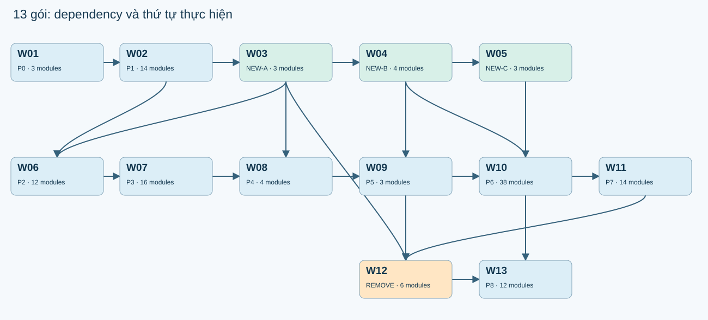

# 08 — Báo cáo bàn giao tổng thể

**Đã hoàn tất bản cập nhật hồ sơ kiến trúc và gói việc** theo phạm vi tài liệu. Phiên bản `leader-field-contracts-20261013-r2`.

Chủ nhiệm DucBao đã chấp thuận cả 23 đề xuất NeedsRule. Các quyết định đã được ghi nhận và áp dụng vào kiến trúc, hợp đồng dữ liệu, gói việc và báo cáo liên quan. S0–S11, 05C, 05D và 13 gói việc đã được xuất lại, tự rà soát và kiểm tra cơ học.

Code sản phẩm chưa được triển khai theo đặc tả mới trong lượt này. Sinh DWG, save/reopen, plot và nghiệm thu DWG/PDF vẫn là **NotRun**; báo cáo này không chứng nhận DBTool đã đạt zero lỗi.

## 1. Nội dung bàn giao

| Hồ sơ | Nội dung đã cập nhật |
|---|---|
| 01 — Bảng tri thức | Giữ nội dung đã được review; thêm trạng thái phê duyệt hiện hành và liên kết đến hồ sơ sửa đổi. |
| 02 — Báo cáo gap | Giữ bằng chứng nghiên cứu đã được review; cập nhật tác động của quyết định chủ nhiệm, không đánh đồng hồ sơ với sản phẩm đã nghiệm thu. |
| 03 — Ma trận module | Giữ 300 quyết định; gắn 116 module BỔ SUNG, 10 VIẾT MỚI và 6 LOẠI BỎ vào gói cụ thể; 168 TÁI SỬ DỤNG không có gói sửa. |
| 04 — NeedsRule | 23/23 đề xuất chuyển thành ApprovedProposal, có nguyên văn quyết định, người phê duyệt, ngày và phiên bản. Tập hợp 11 vấn đề I/O cùng cách xử lý. |
| 05 — Kiến trúc | Thay pseudocode cũ bằng S0–S11 và các helper có thân thuật toán; nhúng input, công thức, nguồn, I/O, interface và lỗi để tài liệu tự chứa spec. |
| 05A — Input | 206 bindings: giữ 205 field trước, thêm Material.G cho vữa đệm; ghi parser, range, enum, tuple arity và dependency. |
| 05B — Công thức | 49 công thức có ID 05B-F01..F49; giữ 24 ID cũ qua alias; ghi nguồn, phạm vi và dữ liệu cần binding. |
| 05C — Hợp đồng triển khai | DTO C# và interfaces đồng bộ với registry và 05D; ghi namespace, project dependency, port contract và migration. |
| 05D — Stage I/O | 12 bảng riêng IN/OUT/FAIL đến field lá; kiểm 11 ranh giới liên tiếp về path, type, unit và nullability. |
| 06 — Kế hoạch | Cập nhật quyết định đã duyệt, dependency và liên kết gói thực thi; giữ acceptance gate dựa trên DWG/PDF thực tế. |
| 07 — Gói việc | 13 prompt tự chứa, cùng format B3.01–B3.12; có TXT, ô Copy nguyên văn, dependency, ownership, token estimate và gate đo được. |
| 08 / INDEX / Audit | Báo cáo tổng thể, mục lục và checklist hiện hành; liên kết bằng chứng kiểm tra và bản sao trước khi sửa. |
| Tài liệu nguồn | Thêm phụ lục phê duyệt r2 và thông báo điều hướng ở INDEX nguồn. Giữ nguyên nội dung nghiên cứu, Excel, PDF và template gốc. |

## 2. Kiến trúc và hợp đồng I/O

| Stage | IN type / số field lá | OUT type / số field lá | Số field lỗi |
|---|---|---|---|
| S0 | EntryStateV2 / 113 | S0StateV2 / 263 | 18 |
| S1 | S0StateV2 / 263 | S1StateV2 / 314 | 18 |
| S2 | S1StateV2 / 314 | S2StateV2 / 441 | 18 |
| S3 | S2StateV2 / 441 | S3StateV2 / 671 | 18 |
| S4 | S3StateV2 / 671 | S4StateV2 / 786 | 18 |
| S5 | S4StateV2 / 786 | S5StateV2 / 818 | 18 |
| S6 | S5StateV2 / 818 | S6StateV2 / 929 | 18 |
| S7 | S6StateV2 / 929 | S7StateV2 / 1000 | 18 |
| S8 | S7StateV2 / 1000 | S8StateV2 / 1078 | 18 |
| S9 | S8StateV2 / 1078 | S9StateV2 / 1107 | 18 |
| S10 | S9StateV2 / 1107 | S10StateV2 / 1126 | 18 |
| S11 | S10StateV2 / 1126 | S11StateV2 / 1171 | 18 |

Toàn bộ 11 ranh giới OUT→IN có cùng path, type, unit và nullability. Registry có 103 record, được đối chiếu 1-1 với các khai báo C# sinh ra. Ba project kiểm hợp đồng được biên dịch theo dependency Domain → Drawing và Domain/Drawing → Application; [log build](data/dto-contract-build.log) ghi kết quả thực tế. Đây là kiểm DTO/interface, không phải build toàn bộ DBTool hoặc chạy thuật toán trong AutoCAD.

05 nhúng bảng field, công thức, nguồn, helper, stage algorithm và type declaration. 05D giữ bảng I/O đầy đủ để tra cứu và kiểm liên tục. [05C](05C-IMPLEMENTATION-CONTRACTS.html) ghi rõ migration và những thay đổi interface; người implement có thể dùng riêng [05](05-ARCHITECTURE.html) hoặc một prompt trong 07 để đọc spec.

## 3. Phê duyệt và dữ liệu vận hành còn thiếu

Không còn đề xuất nào trong 23 mục cũ chờ chủ nhiệm duyệt. Quyết định được lưu với ID `OWNER-APPROVAL-23-20261013`, phiên bản rule `owner-20261013-r2`, cùng nguyên văn đề xuất và nguồn phê duyệt.

Một số đề xuất đã được duyệt yêu cầu dữ liệu nguồn nhưng chưa nêu giá trị cụ thể: radius basis và biểu thức hình dạng, layer stack, embed/hole depth, khẩu độ và tiếp xúc sản phẩm, font/plot hash, tolerance và khoảng hở ink. Phê duyệt phương án không tự tạo các giá trị đó. Runtime seed chỉ điền giá trị đã có nguồn; field chưa đủ dữ liệu giữ trạng thái thiếu binding.

Các nhánh thiếu dữ liệu có schema, consumer, điều kiện kiểm, mã lỗi và debug payload. AI implement phải viết đầy đủ nhánh đó; khi chạy case thiếu binding, hệ thống trả lỗi cụ thể như `RULE_BINDING_DATA_MISSING` thay vì chọn số mặc định. Đây là điều kiện dữ liệu vận hành, không phải yêu cầu duyệt lại 23 đề xuất.

[Quyết định hiện hành](04-NEEDSRULE.html) · [Approval record](data/owner-approval-23.json) · [Runtime seed](data/approved-rule-set-v2.json) · [Binding key schema](data/rule-binding-key-schema-v2.json).

Các vấn đề I/O phát hiện khi sửa được ghi riêng để không trộn với 23 đề xuất đã duyệt:

| Mismatch | Cách xử lý | Trạng thái |
|---|---|---|
| NR-IO-001 | Dùng cumulative immutable stage envelopes; Application adapters wrap leaf payload, Drawing planners không tham chiếu Application. Output N==Input N+1 by generated schema. | ResolvedArchitecture |
| NR-IO-002 | Thêm F-206:CF.Ga!G34 loại2,!G36 loại3;only active BeddingMortar;không lấy Material.F hoặc M75 mẫu. | ResolvedSourceCorrection |
| NR-IO-003 | Giữ FrameBottom=NeckTop,FrameHeight100;contact equations của selected NR23 contract phải xác định NeckTop/PanelBottom/FinishedTop;thiếu field→DATUM_GRAPH_DISCONNECTED. | ApprovedPolicyBindingRequired |
| NR-IO-004 | floorTop=hostTop-clearHeight;floorBottom=floorTop-base;source clearHeight note NOTE0411,PDF040 clear250/base125 chỉ evidence. | ResolvedSourceCorrection |
| NR-IO-005 | Tách Recess/OverOuter theo CoverPanelBuilder;NoCover chỉ dùng explicit selected no-cover aperture/contact,không tự rawE11 authoritative. | ResolvedContractWithBinding |
| NR-IO-006 | NR19 binding ladder_top_surface_id+min_z_expr bắt buộc;missing→RULE_BINDING_DATA_MISSING;không tự RoofTop/FinishedTop. | ApprovedPolicyBindingRequired |
| NR-IO-007 | Bắt buộc width/height expressions NR05;recipe fabrication centreline and nominal schedule separately NR02;missing payload blocks active feature. | ApprovedPolicyBindingRequired |
| NR-IO-008 | Center invariant;Neck forced Center;Body Left/Right requires named side_basis in NR19 placement binding;both signs explicitly implemented. | ApprovedPolicyBindingRequired |
| NR-IO-009 | Outer là rectangle W+2t,H+2t;cut rectangle thêm2m;chamfer chỉ inner cells;surface cover clipping vẫn Euclidean offset riêng. | ResolvedSourceCorrection |
| NR-IO-010 | EX042 chỉ Gang/Purchased;G13 là collar phía trên cổ. Active collar phải có selected source-backed profile/contact expressions;không thay Frame100 hoặc bỏ feature. | ResolvedSourceWithBinding |
| NR-IO-011 | S6 đăng ký Target2V2 ViewTitle/Elevation có ID/frame/point từ biểu thức nguồn. S7 join đúng target, local lane có side; tính vùng cấm theo ink tương đối với port sau scale/rotation. Nhánh accessory không sinh Gach của lưới; helper finite allocator có thân đầy đủ. | ResolvedArchitectureWithSourceBinding |

## 4. Gói việc và thứ tự triển khai

Có 13 gói: 9 phase P0–P8 riêng, 3 nhóm chức năng viết mới và 1 gói gỡ code cùng caller. Ba nhóm viết mới chứa lần lượt 3/4/3 module. Ba file DTO nền tảng bổ sung ở W02 được ghi rõ lý do và phạm vi. Mỗi module cần sửa có một gói sở hữu chính; file dùng chung có quyền sửa đến method để tránh ghi đè code của gói trước.

| Gói | Phase | Chờ | Prompt tokens ước tính | Code output tokens ước tính |
|---|---|---|---|---|
| W01 | P0 | — | 123871–250516 | 4000–32000 |
| W02 | P1 | W01 | 142731–288828 | 12000–46000 |
| W03 | NEW-A | W02 | 209746–423784 | 28000–44000 |
| W04 | NEW-B | W03 | 281396–568507 | 28000–46000 |
| W05 | NEW-C | W02 | 240772–486292 | 24000–42000 |
| W06 | P2 | W02, W03 | 169305–342732 | 4000–32000 |
| W07 | P3 | W06 | 158089–319448 | 12000–46000 |
| W08 | P4 | W07, W03 | 159333–321833 | 4000–32000 |
| W09 | P5 | W08, W04 | 172432–348344 | 4000–32000 |
| W10 | P6 | W09, W04 | 224431–453792 | 12000–46000 |
| W11 | P7 | W10 | 176953–357558 | 4000–32000 |
| W12 | REMOVE | W11, W03, W04 | 236221–477243 | 4000–32000 |
| W13 | P8 | W12, W05 | 242418–489665 | 12000–46000 |

Google công bố Gemini 3.8 Flash có input 1,048,576 và output 65,536 tokens. [Tài liệu model chính thức](https://ai.google.dev/gemini-api/docs/models/gemini-3.8-flash). Các số token trong hồ sơ là ước tính theo ký tự/byte, chưa đo bằng `count_tokens`. Tổng ngân sách ước tính lớn nhất là 762,043 tokens, đã cộng phần đọc source 128,000, output 49,152 và thinking/headroom 16,384.

Nếu làm tuần tự, thực hiện W01→W13. W03 và W05 có thể song song sau W02; W04 và W06 có thể song song sau W03 trên file riêng. W02 kiểm compile DTO/interface trước; module mới phải compile trước khi nối caller. W12 gỡ code sau khi có phần thay thế; W13 nối batch, save/reopen, plot và nghiệm thu thực tế.

Giữ 9 phase riêng theo yêu cầu chủ nhiệm. Không gộp hai nhóm NEW vì ước tính code output của mỗi cặp vượt ngân sách output một lượt; đây là lý do lập kế hoạch, không phải phép đo tokenizer.

## 5. Kết quả kiểm hồ sơ và giới hạn bằng chứng

| Kiểm tra hồ sơ | Expected | Actual | Kết quả |
|---|---|---|---|
| stage_contract_coverage | ['S0', 'S1', 'S2', 'S3', 'S4', 'S5', 'S6', 'S7', 'S8', 'S9', 'S10', 'S11'] | ['S0', 'S1', 'S2', 'S3', 'S4', 'S5', 'S6', 'S7', 'S8', 'S9', 'S10', 'S11'] | Passed |
| eleven_output_input_boundaries | same exact path/type/unit/nullability | [] | Passed |
| all_field_types_resolve | all primitive or declared record | [] | Passed |
| output_leaf_derivation_present | 0 | 0 | Passed |
| csharp_records_one_to_one | 103 | 103 | Passed |
| pseudocode_record_constructors | exact declared fields | [] | Passed |
| formula_references_resolved | all F references exist | [] | Passed |
| pseudocode_stage_coverage | ['S0', 'S1', 'S2', 'S3', 'S4', 'S5', 'S6', 'S7', 'S8', 'S9', 'S10', 'S11'] | ['S0', 'S1', 'S2', 'S3', 'S4', 'S5', 'S6', 'S7', 'S8', 'S9', 'S10', 'S11'] | Passed |
| no_abstract_placeholder_in_pseudocode | 0 | 0 | Passed |
| carry_constructor_expanded | 0 | 0 | Passed |
| 05D_twelve_tables_and_every_leaf | [394, 595, 773, 1130, 1475, 1622, 1765, 1947, 2096, 2203, 2251, 2315] | [394, 595, 773, 1130, 1475, 1622, 1765, 1947, 2096, 2203, 2251, 2315] | Passed |
| module_decision_counts | {'BỔ SUNG': 116, 'TÁI SỬ DỤNG': 168, 'LOẠI BỎ': 6, 'VIẾT MỚI': 10} | {'BỔ SUNG': 116, 'TÁI SỬ DỤNG': 168, 'LOẠI BỎ': 6, 'VIẾT MỚI': 10} | Passed |
| module_package_ownership_exact | each changed module one package,reuse none | [] | Passed |
| package_count_under_15 | 13 <15 | 13 | Passed |
| nine_phases_separate_in_order | ['P0', 'P1', 'P2', 'P3', 'P4', 'P5', 'P6', 'P7', 'P8'] | ['P0', 'P1', 'P2', 'P3', 'P4', 'P5', 'P6', 'P7', 'P8'] | Passed |
| one_copy_prompt_exact_and_B3_consistent | 0 | 0 | Passed |
| no_external_05_spec_dependency | 0 | 0 | Passed |
| token_planning_budget | each below input1048576/outputallocation49152 | [] | Passed |
| all_23_proposals_approved | 23 | 23 | Passed |
| runtime_approval_seed_headers | 23 | 23 | Passed |
| approval_source_schema_exact | SourceV2 fields,no missing required | [] | Passed |
| production_source_unchanged | 290 | 290 | Passed |
| current_html_local_links_exist | 0 | 0 | Passed |

Các kiểm tra trên xác nhận coverage, schema, constructor, tham chiếu công thức, liên kết local, nội dung Copy, ngân sách và hash của hồ sơ. Không dùng số kiểm tra đạt làm bằng chứng sản phẩm đạt chuẩn. Đây là tự rà soát và kiểm tra cơ học, không phải review độc lập. HTML đã được parse và kiểm link tĩnh; không tuyên bố đã kiểm render trong browser.

Mapping VHGpro giữ từ bản trước; không verify độc lập theo yêu cầu chủ nhiệm. Đối chiếu 290 file C# sản phẩm với baseline không phát hiện file thay đổi. Chưa có DWG/PDF mới được đánh Passed trong lượt lập hồ sơ này.

Acceptance thực thi phải ghi expected từ Excel/effective/rule hiện tại, actual từ entity native đã save/reopen hoặc vector PDF, đơn vị, tolerance rule, source IDs và đường dẫn/hash bằng chứng. Không có dữ liệu hoặc chưa chạy host thì ghi BindingMissing/NotRun theo hợp đồng; không tạo bản ghi Passed thay thế.

## 6. Cách sử dụng và khôi phục

Mở [07 — Gói việc](07-WORK-PACKAGES.html), copy nguyên W01, sau đó W02 và tiếp tục theo dependency. Mỗi prompt cần AI coding agent có quyền đọc/sửa workspace DBTool. Spec cần thiết đã được nhúng trong gói; không phải paste thêm các file 05. Kết quả implement gồm code hoàn chỉnh trong workspace, patch và receipt ghi đúng các gate đã chạy.

Bản trước khi sửa nằm trong [history snapshot](history/before-owner-approval-and-05-revision/snapshot.json). Khôi phục đúng file hồ sơ cần thiết và đối chiếu hash; không reset repo hoặc xóa thư mục nguồn. Các script tái tạo hiện hành nằm trong `tmp/dbtool_v2_*`. Script leader cũ có thể ghi đè hồ sơ mới, nên không dùng chúng để tái tạo bản r2.

[Mục lục hiện hành](INDEX.html) · [Audit yêu cầu](REQUIREMENTS-AUDIT.html) · [Manifest file/hash](DELIVERY-MANIFEST.json) · [Kết quả kiểm tra chi tiết](data/verification-v2.json).
